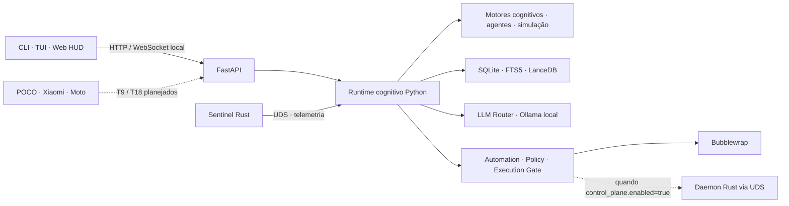

# Arquitetura do NEXUS

**Atualizado:** 2026-11-20
**Escopo:** resumo da implementação presente no repositório
**Referência completa:** [`docs/NEXUS_MASTER_ARCHITECTURE.md`](docs/NEXUS_MASTER_ARCHITECTURE.md)

## Visão atual

O NEXUS é um sistema local-first com runtime Python e daemon de controle Rust.
CLI, TUI, Web HUD e API local acessam o runtime. A API só escuta em loopback.
O daemon Rust assume a autoridade final de execução quando
`[control_plane] enabled = true`; esse modo continua desativado na configuração
padrão.

As conexões tracejadas representam integração futura. Os celulares do diagrama
ainda não têm pairing nem autenticação individual no NEXUS.

## Estado por plano

| Plano | Implementação atual | Limite principal |
|---|---|---|
| Cognitive | Loop adaptativo, motores de intenção/contexto/raciocínio/decisão/plano/conhecimento | Integração mais profunda do planner permanece em evolução |
| Memory & Data | SQLite/WAL, FTS5, LanceDB e Knowledge Graph | Sem namespaces por usuário/dispositivo |
| Intelligence | Registry, runtime, dispatcher, orquestrador e revisão adversária | Sem identidade e dispatch remoto de agentes |
| Simulation | Mundos, relógio, regras, cenários, métricas e resultados persistentes | Execução de agentes dentro dos mundos é parcial |
| Execution | Policy, HITL, Execution Gate, sandbox, journal e sete ferramentas read-only | Catálogo de ferramentas de escrita ainda não está habilitado |
| Control Plane | Daemon Rust, IPC e store persistente de aprovações/execuções | Autoridade Rust é opt-in e falta validar no Acer |
| Distributed | Nós, scheduler, Event Fabric e WebSocket entre nós | Multi-dispositivo autenticado e malha de LLMs pendentes |

## Fronteiras importantes

- A API usa token local único e bind de loopback. TLS e autenticação por
  dispositivo pertencem ao T9.
- O Execution Gate recebe identidade/capacidade locais; o T8 ainda precisa
  integrar principals, devices e escopos ao ciclo de execução.
- Ferramentas reais não devem ser adicionadas sem política, aprovação,
  isolamento e auditoria.
- O Acer Nitro V15 é o servidor alvo. O Dell Inspiron 15 3511 é a estação de
  desenvolvimento; a implantação do T7 continua pendente no Acer.

## Próximas etapas

O caminho atual é T7 (host, rede e backup), T8 (identidade), T9–T13 (gateway,
eventos, dados, memória e perfis), T14–T18 (modelos, execução, agentes e
clientes), T19 (DR) e T20 (voz, ambiente e robótica). O estado e as dependências
estão em [`ROADMAP.md`](ROADMAP.md).
